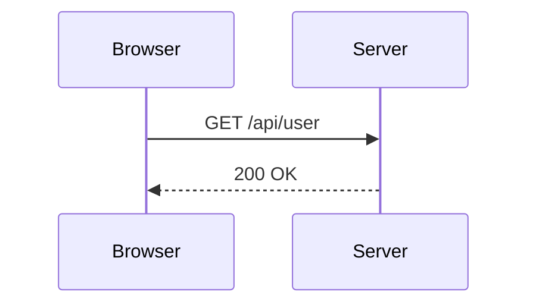

## What is a Markdown viewer?

**Markdown** is a lightweight markup language for formatting plain text, used for README files,
documentation, notes and wikis, with `.md` or `.markdown` extensions. A Markdown viewer turns
that plain text into a formatted document: headings, lists, tables, links, images and code.

Difff's Markdown viewer renders your file right in the browser. Nothing is uploaded to a server:
the file is read and rendered locally.

### What the viewer supports:

- GitHub Flavored Markdown (GFM): tables, task lists, strikethrough and autolinks.
- Syntax highlighting for fenced code blocks: TypeScript, JavaScript, Python, Go, Rust, SQL, YAML, JSON, Bash and more.
- Mermaid diagrams: flowcharts, sequence diagrams, class diagrams, state diagrams, ER diagrams, Gantt charts and pie charts.
- Drag & drop for `.md`, `.markdown`, `.mdx` and `.txt` files.

## How to view a Markdown file

Drag & drop a Markdown file anywhere on the page, or click the drop zone to pick a file.
The document renders instantly. Drop another file to replace it.

### Code blocks with syntax highlighting

Add the language name after the opening backticks:

````md
```ts
const greet = (name: string): string => `Hello, ${name}!`;
```
````

### Mermaid diagrams

Use `mermaid` as the code block language and the diagram is rendered as an image:

````md

````

Working with data files too? Try the [JSON formatter](/), [YAML formatter](/formatter/yaml)
or [JSON to YAML converter](/converter/json-to-yaml).
